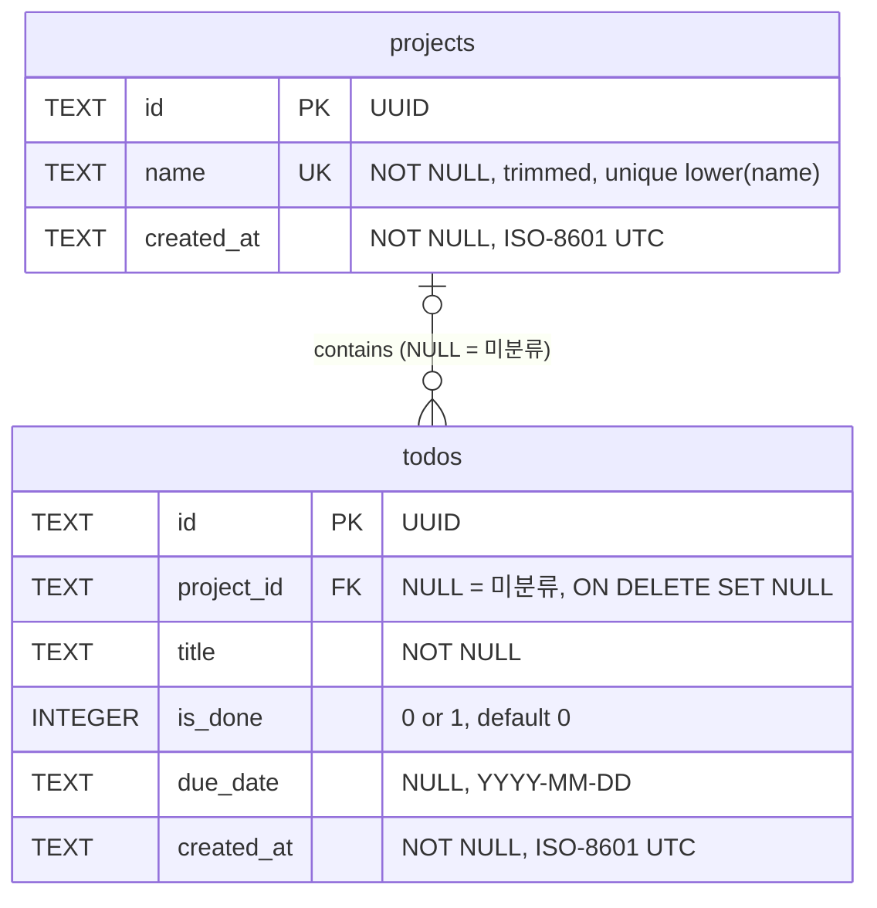
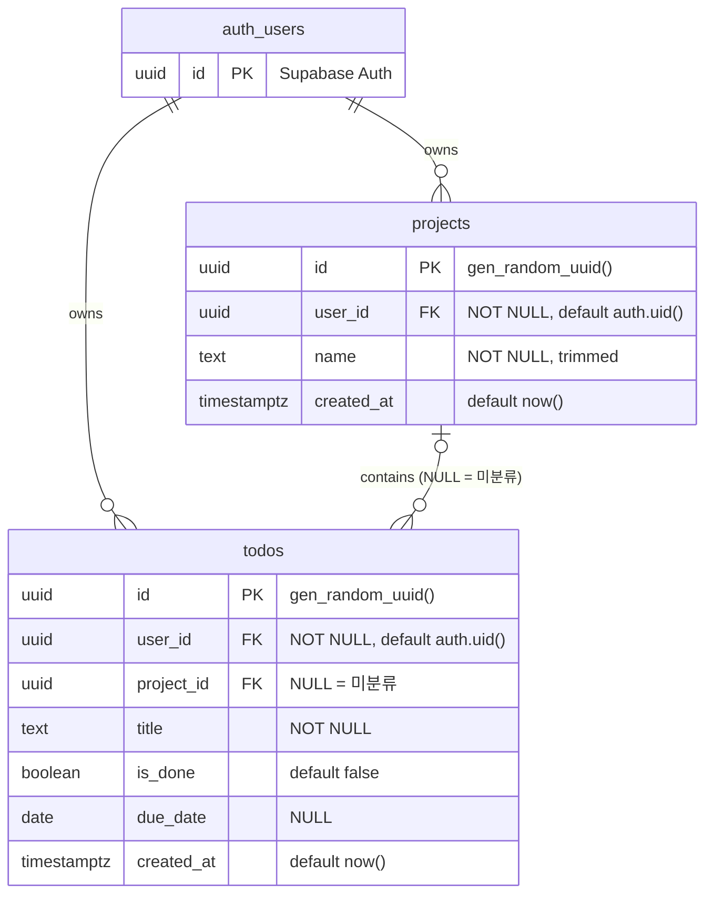

# Project Todo — 데이터베이스 설계 (Step 1, 개정 1)

> 상태: **확정 (2026-10-29)**. 아직 DB 파일·스키마·소스코드는 만들지 않았다.
> 아래 SQL은 설계 확인용이며 실행하지 않았다.

## 0. 확정된 결정 (2026-10-29 검토)

| # | 결정 | 설계 반영 |
|---|---|---|
| 1 | 미분류 할 일 허용 | `todos.project_id` NULL 허용, 미분류는 레코드 없이 `project_id IS NULL` 로 표현, 프로젝트 삭제 시 `SET NULL` |
| 2 | UUID 기본키 | Supabase `uuid default gen_random_uuid()`, SQLite는 같은 형식의 36자 `TEXT` |
| 3 | todos에도 `user_id` 유지 | 복합 외래키 `(project_id, user_id) → projects(id, user_id)` 로 소유자 일치를 DB가 보장, 삭제 시 `project_id` 만 NULL |
| 4 | 프로젝트 이름 중복 금지 | 사용자별 `UNIQUE (user_id, lower(name))`, 앞뒤 공백 제거 후 저장, 빈 이름 금지 |

## 1. 요구사항 분석

| PRD 요구사항 | 설계 결정 |
|---|---|
| 프로젝트 생성·이름 지정 | `name` 필수. 앞뒤 공백을 제거한 값만 저장(CHECK). 빈 문자열 금지 |
| 프로젝트 이름 중복 금지 | 대소문자 무시 유니크 인덱스. 로컬은 `lower(name)`, 클라우드는 `(user_id, lower(name))` |
| 할 일 CRUD | `title`, `due_date`, `is_done`, `project_id` 수정 가능 |
| 미분류 할 일 | `project_id = NULL`. 화면의 "미분류"는 UI가 만드는 가상 항목 |
| 배정 / 미분류로 변경 | `UPDATE todos SET project_id = :id` / `= NULL` |
| 프로젝트 삭제 시 미분류로 이동 | FK `ON DELETE SET NULL` (클라우드는 `SET NULL (project_id)` 로 `user_id` 보존) |
| 프로젝트별 / 미분류 개수 | **저장하지 않고** 집계 쿼리로 계산 |
| 마감일 선택사항 | `due_date` NULL 허용, 날짜만 |
| 마감 지난 미완료 구분 | **컬럼 없음**: `is_done = false AND due_date < :today` |
| 마감일 순 정렬 | `ORDER BY due_date IS NULL, due_date, created_at` (마감일 없음은 뒤로) |
| 재실행 후 유지·오프라인 | 로컬 SQLite 파일 (예: `data/todo.db`, Git 제외) |
| 사용자별 접근 제한 | 두 테이블 `user_id` + 작업별 RLS 정책 |
| DB 로직과 화면 로직 분리 | 저장소 계층이 0/1↔boolean, 오류코드→도메인 오류 변환을 담당 |

`:today` 는 앱이 **사용자 로컬 날짜**로 계산해 넘긴다 (SQLite `date('now')` 는 UTC라 오전 9시 전 하루 어긋남).

## 2. 로컬 SQLite 설계

로컬은 단일 사용자이므로 `user_id` 와 인증이 없다. ID 형식만 클라우드와 맞춘다.

### projects

| 컬럼 | 자료형 | 제약 | 설명 |
|---|---|---|---|
| `id` | `TEXT` | `PRIMARY KEY NOT NULL`, `CHECK (length(id) = 36)` | UUID v4 소문자 문자열. Python 백엔드가 `uuid.uuid4()` 로 생성 |
| `name` | `TEXT` | `NOT NULL`, `CHECK (name = trim(name) AND length(name) > 0)` | 앱이 trim 후 저장 |
| `created_at` | `TEXT` | `NOT NULL`, 기본값 현재 UTC | ISO-8601 |

- 유니크 인덱스 `lower(name)` → `Work` / `work` / ` work ` 는 같은 이름으로 거부된다.
  (SQLite `lower()` 는 ASCII만 변환 — 요구사항 "영문 대소문자"와 정확히 일치)

### todos

| 컬럼 | 자료형 | 제약 | 설명 |
|---|---|---|---|
| `id` | `TEXT` | `PRIMARY KEY NOT NULL`, `CHECK (length(id) = 36)` | UUID |
| `project_id` | `TEXT` | **NULL 허용**, `REFERENCES projects(id) ON DELETE SET NULL` | NULL = 미분류 |
| `title` | `TEXT` | `NOT NULL`, `CHECK (length(trim(title)) > 0)` | 할 일 제목 |
| `is_done` | `INTEGER` | `NOT NULL DEFAULT 0`, `CHECK (is_done IN (0, 1))` | 완료 여부 |
| `due_date` | `TEXT` | NULL 허용 | `YYYY-MM-DD` |
| `created_at` | `TEXT` | `NOT NULL`, 기본값 현재 UTC | ISO-8601 |

### DDL

```sql
PRAGMA foreign_keys = ON;  -- 연결마다 필요. 꺼져 있으면 SET NULL도 동작하지 않는다

CREATE TABLE projects (
  id         TEXT PRIMARY KEY NOT NULL CHECK (length(id) = 36),
  name       TEXT NOT NULL CHECK (name = trim(name) AND length(name) > 0),
  created_at TEXT NOT NULL DEFAULT (strftime('%Y-%m-%dT%H:%M:%fZ', 'now'))
);
CREATE UNIQUE INDEX ux_projects_name_ci ON projects (lower(name));

CREATE TABLE todos (
  id         TEXT PRIMARY KEY NOT NULL CHECK (length(id) = 36),
  project_id TEXT REFERENCES projects(id) ON DELETE SET NULL,
  title      TEXT NOT NULL CHECK (length(trim(title)) > 0),
  is_done    INTEGER NOT NULL DEFAULT 0 CHECK (is_done IN (0, 1)),
  due_date   TEXT,
  created_at TEXT NOT NULL DEFAULT (strftime('%Y-%m-%dT%H:%M:%fZ', 'now'))
);
CREATE INDEX ix_todos_project_id ON todos (project_id);
```

`TEXT PRIMARY KEY` 는 SQLite 레거시 동작으로 NULL이 들어갈 수 있어 `NOT NULL` 을 명시했다.

### 대표 쿼리

```sql
-- 좌측 목록: 프로젝트별 개수
SELECT p.id, p.name,
       COUNT(t.id)                 AS total_count,
       COALESCE(SUM(t.is_done), 0) AS done_count
FROM projects p
LEFT JOIN todos t ON t.project_id = p.id
GROUP BY p.id
ORDER BY p.created_at;

-- 좌측 목록: 미분류 개수
SELECT COUNT(*) AS total_count, COALESCE(SUM(is_done), 0) AS done_count
FROM todos WHERE project_id IS NULL;

-- 중앙 목록: 선택 항목의 할 일 (프로젝트면 :projectId, 미분류면 NULL)
SELECT t.*,
       (t.is_done = 0 AND t.due_date IS NOT NULL AND t.due_date < :today) AS is_overdue
FROM todos t
WHERE t.project_id IS :projectId          -- IS 는 NULL끼리도 일치
ORDER BY t.due_date IS NULL, t.due_date, t.created_at;
```

## 3. 관계 정의

| 관계 | 카디널리티 | 구현 | 삭제 시 |
|---|---|---|---|
| projects → todos | **0..1 : N** (할 일은 프로젝트가 없거나 하나) | `todos.project_id` FK, NULL 허용 | `SET NULL` → 미분류로 이동 |
| auth.users → projects (클라우드) | 1 : N | `projects.user_id` FK | 사용자 삭제 시 `CASCADE` |
| auth.users → todos (클라우드) | 1 : N | `todos.user_id` FK | 사용자 삭제 시 `CASCADE` |
| 소유자 일치 (클라우드) | — | 복합 FK `(project_id, user_id) → projects(id, user_id)` | `SET NULL (project_id)` — `user_id` 유지 |

## 4. ERD

### 로컬 SQLite



### Supabase



Supabase 제약 요약 (ERD로 표현하기 어려운 부분):

- `projects`: `UNIQUE (id, user_id)` — 복합 FK의 참조 대상
- `projects`: `UNIQUE (user_id, lower(name))` — 사용자별 이름 중복 금지
- `todos`: `FOREIGN KEY (project_id, user_id) REFERENCES projects (id, user_id) ON DELETE SET NULL (project_id)`

## 5. Supabase 전환 설계

### 5-1. 자료형 대응

| 컬럼 | SQLite | Supabase | 비고 |
|---|---|---|---|
| `id` | `TEXT` (UUID) | `uuid default gen_random_uuid()` | 같은 값을 그대로 이관 가능 |
| `user_id` | 없음 | `uuid not null default auth.uid()` | `auth.users.id` 와 동일 타입 |
| `project_id` | `TEXT` NULL | `uuid` NULL | |
| `name`, `title` | `TEXT` | `text` | |
| `is_done` | `INTEGER` 0/1 | `boolean` | 저장소 계층에서 변환 |
| `due_date` | `TEXT 'YYYY-MM-DD'` | `date` | |
| `created_at` | `TEXT ISO-8601` | `timestamptz default now()` | |

ID 생성 위치: SQLite 저장소는 Python 백엔드가 `uuid.uuid4()` 로 만들어 넣고(브라우저는 ID를 만들지 않음), Supabase 저장소는 `id` 를 보내지 않아 DB 기본값을 쓴다. UI와 업무 로직은 둘 다 "문자열 ID"만 다룬다.

### 5-2. DDL

```sql
create table public.projects (
  id         uuid primary key default gen_random_uuid(),
  user_id    uuid not null default auth.uid()
             references auth.users (id) on delete cascade,
  name       text not null check (name = btrim(name) and name <> ''),
  created_at timestamptz not null default now(),
  constraint projects_id_user_id_key unique (id, user_id)
);

-- 같은 사용자 안에서 대소문자 무시 중복 금지 (다른 사용자끼리는 허용)
create unique index projects_user_name_ci_key
  on public.projects (user_id, lower(name));

create table public.todos (
  id         uuid primary key default gen_random_uuid(),
  user_id    uuid not null default auth.uid()
             references auth.users (id) on delete cascade,
  project_id uuid,
  title      text not null check (length(btrim(title)) > 0),
  is_done    boolean not null default false,
  due_date   date,
  created_at timestamptz not null default now(),

  -- 할 일 소유자 = 프로젝트 소유자 를 DB가 보장
  -- project_id 가 NULL(미분류)이면 MATCH SIMPLE 규칙에 따라 검사하지 않음
  constraint todos_project_owner_fkey
    foreign key (project_id, user_id)
    references public.projects (id, user_id)
    on delete set null (project_id)   -- user_id는 유지, project_id만 NULL
);

create index todos_user_project_idx on public.todos (user_id, project_id);
```

설계 포인트:

- **복합 FK가 소유자 불일치를 원천 차단한다.** 사용자 B의 할 일(`user_id = B`)에 A의 프로젝트 ID를 넣으면 `(A프로젝트, B)` 조합이 `projects` 에 없으므로 FK 위반(`23503`)으로 거부된다. RLS가 아닌 **제약조건**이 막으므로 정책 실수와 무관하게 보장된다.
- **`ON DELETE SET NULL (project_id)`**: 일반 `SET NULL` 은 복합 FK의 모든 컬럼(`user_id` 포함)을 NULL로 만들려다 `NOT NULL` 위반이 난다. 컬럼 목록 지정 문법(PostgreSQL 15+, Supabase 기본 버전에서 지원)으로 `project_id` 만 비운다.
- `projects.user_id` 로 시작하는 두 유니크 인덱스가 `user_id` 조회 인덱스 역할도 하므로 별도 인덱스는 두지 않는다. `todos(user_id, project_id)` 하나로 RLS 필터, 프로젝트별/미분류 조회, FK의 `SET NULL` 탐색을 모두 처리한다.
- 이름 정규화는 "trim은 저장 전 앱이 수행 + DB는 CHECK로 검증", "대소문자 무시는 DB 인덱스"로 나눴다. 화면에는 사용자가 입력한 대소문자 그대로 표시된다.

### 5-3. RLS — 작업별 정책

```sql
alter table public.projects enable row level security;
alter table public.todos    enable row level security;

-- projects
create policy projects_select on public.projects
  for select to authenticated using (user_id = (select auth.uid()));
create policy projects_insert on public.projects
  for insert to authenticated with check (user_id = (select auth.uid()));
create policy projects_update on public.projects
  for update to authenticated
  using (user_id = (select auth.uid())) with check (user_id = (select auth.uid()));
create policy projects_delete on public.projects
  for delete to authenticated using (user_id = (select auth.uid()));

-- todos
create policy todos_select on public.todos
  for select to authenticated using (user_id = (select auth.uid()));
create policy todos_insert on public.todos
  for insert to authenticated with check (user_id = (select auth.uid()));
create policy todos_update on public.todos
  for update to authenticated
  using (user_id = (select auth.uid())) with check (user_id = (select auth.uid()));
create policy todos_delete on public.todos
  for delete to authenticated using (user_id = (select auth.uid()));
```

- 정책은 "내 행인가"만 판단하고, "내 프로젝트에만 연결 가능한가"는 복합 FK가 판단한다. 그래서 정책에 `EXISTS` 서브쿼리가 필요 없다.
- `to authenticated` 만 허용하므로 비로그인(`anon`) 요청은 아무 행도 읽거나 쓸 수 없다.
- `UPDATE ... WITH CHECK` 로 행의 `user_id` 를 다른 사용자로 바꾸는 것(소유권 넘기기)을 막는다.
- 앱에는 anon(publishable) 키만 `.env` 로 넣는다. RLS를 우회하는 `service_role` 키는 클라이언트·Git에 넣지 않는다.

### 5-3-1. 테이블 권한 (Step 3 구현 시 추가)

테이블 구조 변경은 아니며, 실행용 SQL은 `supabase/schema.sql` 에 있다.

```sql
revoke all on table public.projects, public.todos from anon, authenticated;
grant select, insert, update, delete on table public.projects, public.todos to authenticated;
```

- Supabase는 새 테이블에 `anon`·`authenticated` 권한(TRUNCATE 등 포함)을 자동 부여한다. 모두 회수한 뒤 로그인 사용자에게 4가지 작업만 다시 준다.
- 비로그인(`anon`) 요청은 RLS 이전에 테이블 권한 단계에서 거부된다 (이중 방어).
- `TRUNCATE` 는 RLS 정책의 적용을 받지 않으므로 권한 자체를 주지 않는다.

**SQLite와의 동작 차이 (구조 변경 없음):** PostgreSQL `lower()` 는 `Ä/ä` 같은 비ASCII 라틴 문자도 소문자로 바꾸지만 SQLite `lower()` 는 ASCII만 바꾼다. 요구사항은 "영문 대소문자"이고 한글에는 대소문자가 없으므로 영향이 없다.

### 5-4. 인증

- Supabase Auth 이메일/비밀번호 로그인(무료)으로 충분하다.
- 로컬 SQLite 모드는 인증 없이 동작한다.

### 5-5. 로컬 → 클라우드 데이터 이관 (선택)

ID가 같은 UUID 형식이므로 `id`, `project_id` 를 그대로 복사하고 `user_id` 만 현재 로그인 사용자로 채우면 된다. 프로젝트를 먼저, 할 일을 나중에 넣는다.

## 6. 검증 계획

### 6-1. RLS 작업별 검증 (사용자 A, B / 비로그인)

| 작업 | 시나리오 | 기대 결과 |
|---|---|---|
| SELECT | A가 projects / todos 조회 | A의 행만 반환 |
| SELECT | B가 A의 프로젝트·할 일 ID로 조회 | 0건 |
| SELECT | 비로그인 조회 | 0건 |
| INSERT | A가 자기 프로젝트·할 일·미분류 할 일 생성 | 성공, `user_id = A` 자동 입력 |
| INSERT | A가 `user_id = B` 를 지정해 생성 | RLS 위반(`42501`) |
| INSERT | A가 B의 `project_id` 로 할 일 생성 | FK 위반(`23503`) |
| UPDATE | B가 A의 할 일 제목·완료 여부 수정 | 영향 0건 |
| UPDATE | A가 자기 할 일의 `user_id` 를 B로 변경 | RLS 위반 |
| UPDATE | A가 자기 할 일의 `project_id` 를 B의 프로젝트로 변경 | FK 위반 |
| UPDATE | A가 자기 할 일을 미분류로 변경 / 다시 자기 프로젝트에 배정 | 성공 |
| DELETE | B가 A의 프로젝트·할 일 삭제 | 영향 0건, 데이터 유지 |
| DELETE | A가 자기 프로젝트 삭제 | 성공, 소속 할 일은 `project_id = NULL`, `user_id = A` 유지 |

### 6-2. 제약조건 검증 (로컬·클라우드 공통)

| 시나리오 | 기대 결과 |
|---|---|
| 프로젝트 이름 `''` 또는 공백만 | 거부 (앱 검증 + CHECK) |
| `Work` 가 있는데 `work`, ` WORK ` 생성 | 거부 (유니크 인덱스) |
| A의 `Work` 가 있을 때 B가 `Work` 생성 (클라우드) | 허용 |
| 프로젝트 이름을 기존 다른 프로젝트 이름(대소문자만 다름)으로 수정 | 거부 |
| 프로젝트 삭제 | 할 일 유지, 미분류로 표시 |

저장소 계층은 중복 오류(SQLite `SQLITE_CONSTRAINT_UNIQUE` / PostgreSQL `23505`)를 같은 도메인 오류("이미 같은 이름의 프로젝트가 있습니다")로 변환해 UI에 넘긴다.

## 7. 복잡도 검토

**결론: 여전히 테이블 2개이며 과제 수준에 적절하다.** 이번 개정으로 늘어난 것은 결정 사항을 지키는 데 꼭 필요한 제약조건뿐이다.

| 추가 요소 | 필요한 이유 | 더 단순한 대안을 택하지 않은 이유 |
|---|---|---|
| `projects UNIQUE (id, user_id)` | 복합 FK의 참조 대상 | 결정 3 "DB 차원 보장" 요구 |
| 복합 FK + `SET NULL (project_id)` | 소유자 일치 보장 + 삭제 시 `user_id` 보존 | 트리거는 더 복잡하고, RLS `EXISTS` 는 DB 제약이 아님 |
| `lower(name)` 유니크 인덱스 | 대소문자 무시 중복 금지 | `citext` 확장은 로컬 SQLite와 동작이 달라짐 |
| 이름 trim CHECK | 공백 차이 중복 방지 | 트리거로 자동 trim 하는 것보다 단순 |

여전히 **넣지 않은** 것: `users`/`profiles` 테이블, "미분류" 시스템 프로젝트 레코드, 개수·지연 여부 저장 컬럼, `updated_at`, `status` enum, 우선순위·태그, 소프트 삭제, `citext` 확장, 트리거.
