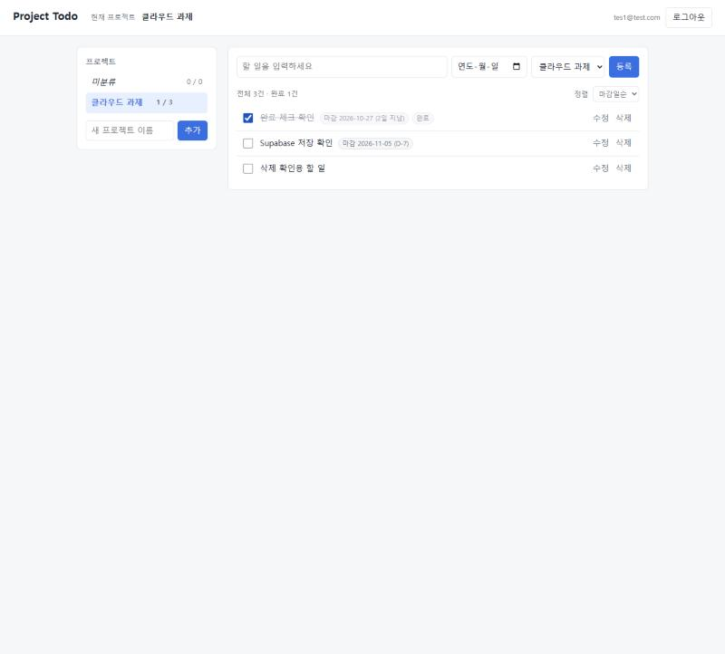
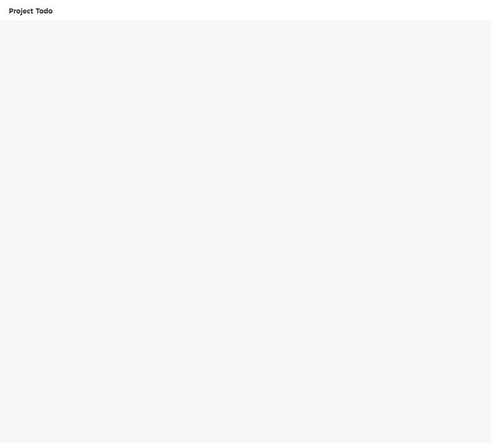
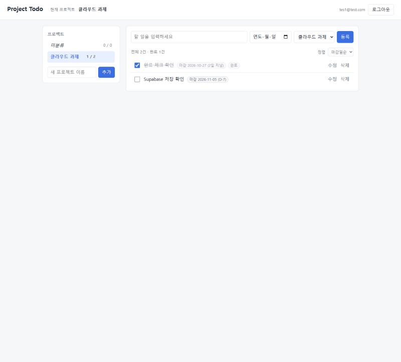
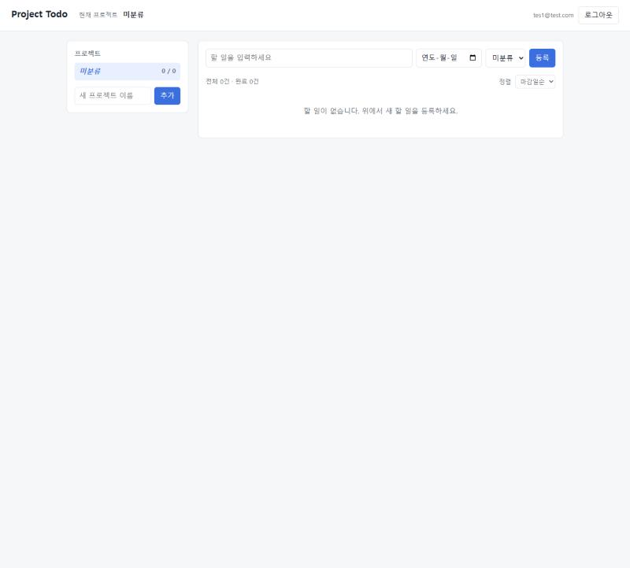
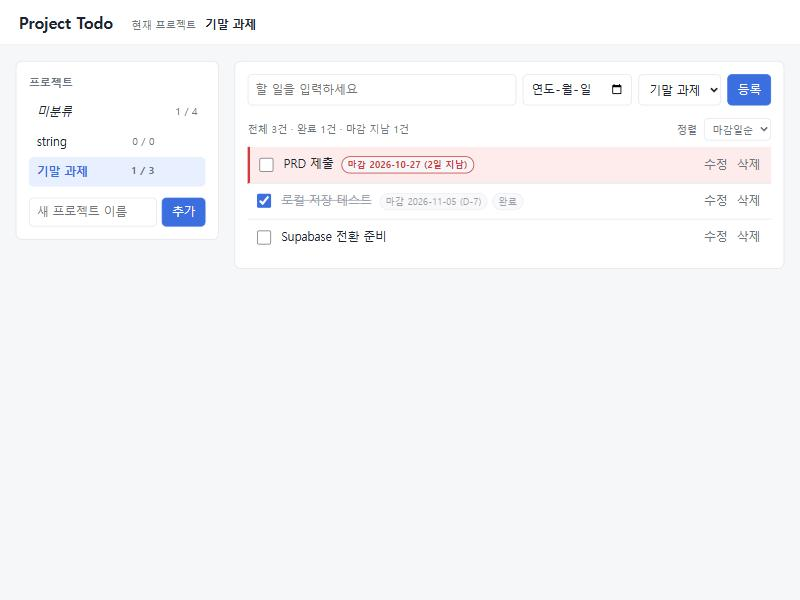
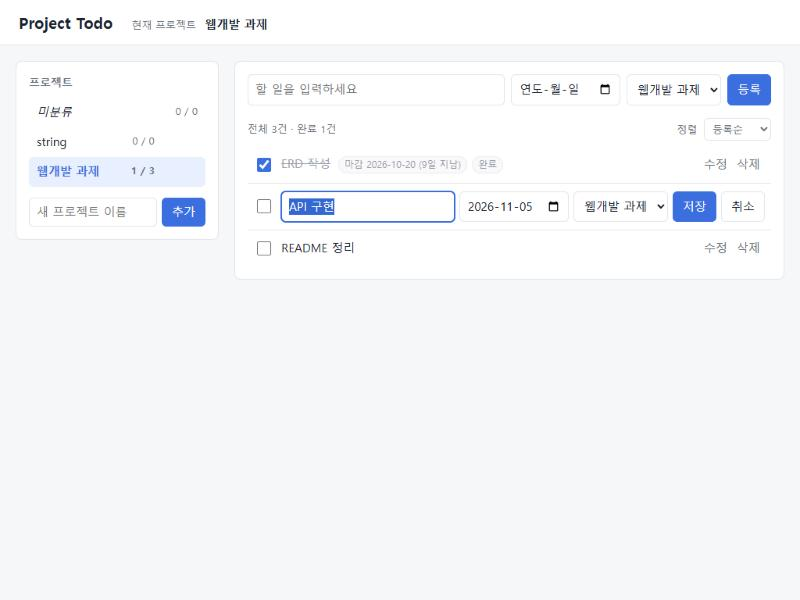
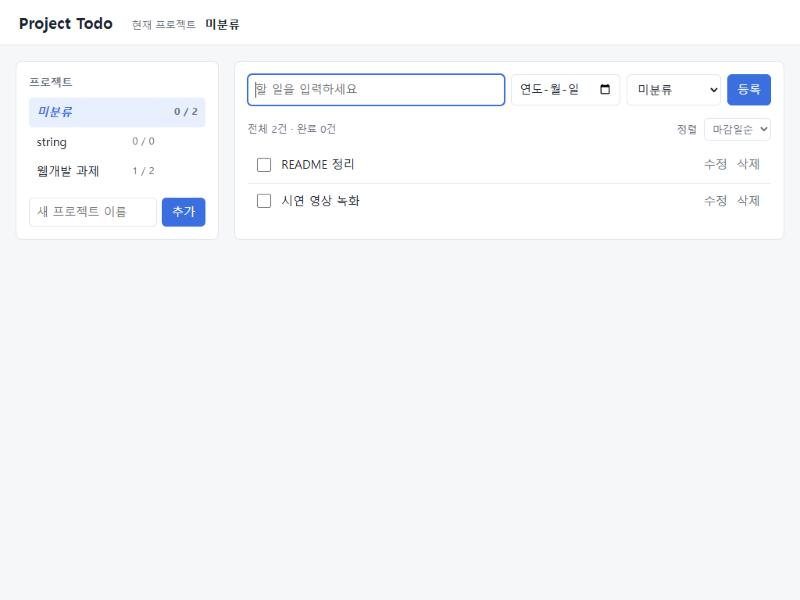
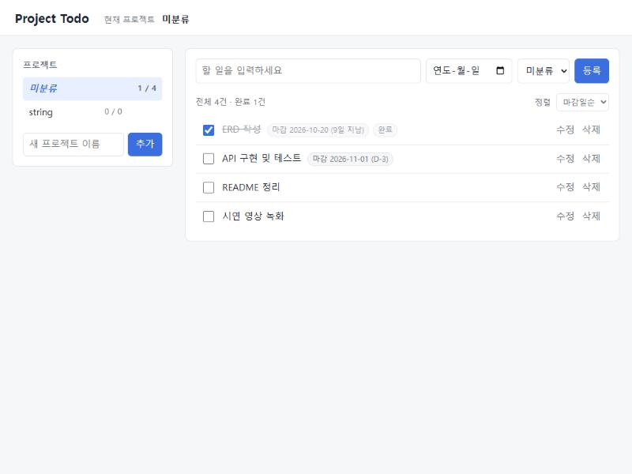
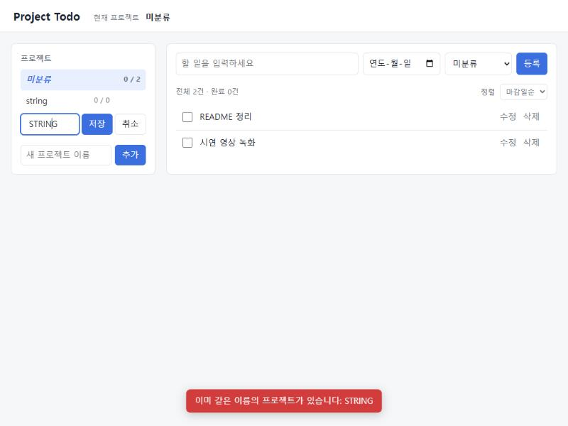

# Project Todo

## 과제 D-7 제출물 안내

길 A(로컬 SQLite)로 완성한 Todo 앱을 길 B(Supabase + RLS)로 전환한 결과물입니다.

| 평가 기준 | 확인할 곳 |
|---|---|
| **PRD 한 장** (30점) | [PRD.md](PRD.md) |
| **데이터가 남는 Todo 앱** — CRUD, 앱을 껐다 켜도 데이터 유지 (40점) | [작동 화면](#작동-화면) · [TEST_LOG.md](TEST_LOG.md) §1 (로컬), §2-5 (클라우드) |
| **로컬·클라우드 저장과 보안 확인** — 클라우드 전환·RLS 기록 (30점) | [TEST_LOG.md](TEST_LOG.md) §2 · [RLS 검증 결과 26/26](docs/rls_check_result.md) · [클라우드 영속성 결과](docs/cloud_persistence_result.md) |

**한 줄 기록**

- 클라우드 전환: 저장소 인터페이스를 유지한 채 `DB_BACKEND=supabase` 로 Supabase(PostgreSQL)에 저장하고, 서버 완전 종료·재시작 후 재로그인해도 데이터가 그대로임을 확인했다.
- RLS 확인: 테스트 계정 A·B 의 일반 사용자 토큰으로 Supabase 에 직접 요청해, B 가 A 의 데이터를 조회·수정·삭제·연결할 수 없고 비로그인 요청도 거부됨을 26개 항목 모두 통과로 확인했다.

참고 문서: [DB_DESIGN.md](DB_DESIGN.md) (DB 설계) · [supabase/schema.sql](supabase/schema.sql) (테이블·RLS) · [DEPLOY.md](DEPLOY.md) (Render 배포 준비, 실제 배포는 하지 않음)

### 작동 화면

**클라우드 (Supabase 모드, 테스트 계정 B 로 로그인)** — 절차와 DB 직접 확인 결과: [TEST_LOG.md](TEST_LOG.md) §2-8

| 화면 | 설명 |
|---|---|
|  | ① 할 일 3건이 Supabase 에 저장된 화면 |
|  | ② 완료 체크 → 취소선·"완료" 표시, 개수 1/3 |
|  | ③ 할 일 삭제 → 개수 1/2 (DB 에서도 행 삭제 확인) |
|  | ④ 로컬 FastAPI 서버 완전 종료 중 — 데이터를 불러오지 못함 |
|  | ⑤ 서버 재시작 후 접속 — 완료·삭제 상태 그대로 유지 |
|  | 계정 B 첫 로그인 — 계정 A 의 데이터가 보이지 않음 (RLS) |

**로컬 (SQLite 모드)** — 서버 재시작 전후 API 응답 비교 절차: [TEST_LOG.md](TEST_LOG.md) §1-3

| 화면 | 설명 |
|---|---|
|  | 프로젝트·할 일 등록, 완료 체크(취소선), 마감 지난 미완료(빨간색) |
|  | 서버 완전 종료·재시작 후 같은 데이터 |
|  | 할 일 제목·마감일·소속 프로젝트 수정 |
|  | 미분류 할 일 |
|  | 프로젝트 삭제 시 소속 할 일이 미분류로 이동 |
|  | 프로젝트 이름 중복(대소문자·공백 무시) 거부 |

---

여러 프로젝트의 할 일을 나눠 관리하는 웹 Todo 앱. 저장소를 두 가지 중에서 고를 수 있다.

| 모드 | `.env` 의 `DB_BACKEND` | 데이터 위치 | 로그인 |
|---|---|---|---|
| 길 A | `sqlite` (기본값) | 로컬 `todo.db` | 없음 |
| 길 B | `supabase` | Supabase PostgreSQL (RLS 로 사용자별 격리) | 필요 (Supabase Auth) |

- 요구사항: [PRD.md](PRD.md)
- DB 설계: [DB_DESIGN.md](DB_DESIGN.md)
- 검증 기록: [TEST_LOG.md](TEST_LOG.md)
- 배포 준비: [DEPLOY.md](DEPLOY.md)

## 기능

- 프로젝트 생성·이름 수정·삭제 (삭제 시 소속 할 일은 미분류로 이동)
- 프로젝트 이름 중복 금지 (앞뒤 공백 제거, 영문 대소문자 무시)
- 할 일 등록·조회·수정·삭제, 완료 체크
- 미분류 할 일 (프로젝트 없이 등록, 프로젝트 배정 / 미분류로 변경)
- 마감일 (선택), 마감 지난 미완료 업무 빨간 표시, 마감일순 정렬
- 프로젝트별·미분류 전체/완료 개수 표시

## 구조

```
브라우저 (frontend/)  ──fetch /api/*──▶  FastAPI (backend/api)  ──▶  Repository  ──▶  todo.db
```

| 경로 | 역할 |
|---|---|
| `frontend/` | HTML·CSS·JS 화면. `api.js` 만 서버와 통신하며 DB를 모른다 |
| `backend/api/` | REST API 라우터, 의존성(저장소·현재 사용자) |
| `backend/domain.py` | DB와 무관한 업무 규칙(입력 정규화, 오류) |
| `backend/repositories/` | 저장소 인터페이스(`base.py`)와 SQLite 구현(`sqlite_repo.py`, SQL은 여기에만) |
| `backend/db/` | `schema.sql`, SQLite 연결·초기화 |
| `tests/` | pytest 테스트 |

`todo.db` 는 서버 첫 실행 시 자동 생성되며, `frontend/` 밖에 있어 브라우저에서 내려받을 수 없다.

## 실행 방법 (Windows)

준비물: Python 3.11 이상. 모든 패키지는 프로젝트 안의 `.venv` 에만 설치된다.

1) 가상환경 생성 (최초 1회)

```bash
python -m venv .venv
```

2) 패키지 설치 (최초 1회)

```bash
.venv/Scripts/python -m pip install -r requirements.txt -r requirements-dev.txt
```

3) (선택) 설정 파일 — 기본값으로 충분하면 생략 가능

```bash
cp .env.example .env
```

4) 서버 실행 후 브라우저에서 http://localhost:8000 접속 (종료: `Ctrl + C`)

```bash
.venv/Scripts/python -m uvicorn backend.main:app --port 8000
```

API 문서(Swagger UI): http://localhost:8000/docs

5) 테스트

```bash
.venv/Scripts/python -m pytest
```

## Supabase 모드 (길 B)

1. Supabase 프로젝트 생성 → SQL Editor 에서 [`supabase/schema.sql`](supabase/schema.sql) 실행 (테이블·권한·RLS)
2. Authentication → Users → **Add user → Create new user** (Auto Confirm 체크) 로 사용자 생성 — 앱에는 회원가입이 없다
3. `.env` 작성 (`.env.example` 참고, Git 에 올라가지 않음)
   - `DB_BACKEND=supabase`, `COOKIE_SECURE=false`
   - `SUPABASE_URL`, `SUPABASE_PUBLISHABLE_KEY` (Project Settings → Data API / API Keys) — **secret 키는 넣지 않는다**
4. 서버 실행 후 http://localhost:8000 에서 로그인

검증 스크립트 (`.env` 에 테스트 계정 `RLS_TEST_A_*`, `RLS_TEST_B_*` 필요):

```bash
.venv/Scripts/python -m scripts.rls_check
```

```bash
.venv/Scripts/python -m scripts.cloud_persistence before
```

동작 방식: 백엔드가 로그인 사용자의 토큰을 Supabase REST 요청에 실어 보내고, DB 의 RLS 정책이 그 사용자 행만 허용한다. 토큰은 HttpOnly 쿠키에만 저장되어 화면 JavaScript 에서 읽을 수 없다.

## API

| 메서드 | 경로 | 설명 |
|---|---|---|
| GET | `/api/projects` | 프로젝트 목록 + 개수, 미분류 개수 |
| POST | `/api/projects` | `{"name": "..."}` 생성 (중복 409) |
| PATCH | `/api/projects/{id}` | 이름 수정 |
| DELETE | `/api/projects/{id}` | 삭제 (할 일은 미분류로) |
| GET | `/api/todos?project={id}\|unassigned&sort=created\|due` | 할 일 목록 |
| POST | `/api/todos` | `{"title", "project_id"?, "due_date"?}` 생성 |
| PATCH | `/api/todos/{id}` | 보낸 필드만 수정 (`project_id`/`due_date` 에 `null` = 미분류/마감일 제거) |
| DELETE | `/api/todos/{id}` | 삭제 |
| GET | `/api/auth/me` | 로그인 필요 여부·현재 사용자 (supabase 모드) |
| POST | `/api/auth/login` · `/api/auth/logout` · `/api/auth/refresh` | 로그인·로그아웃·토큰 갱신 (supabase 모드) |

## todo.db 직접 확인하기

**DB Browser for SQLite** (무료, https://sqlitebrowser.org)

1. 설치 후 실행 → **Open Database** 클릭
2. 파일 선택 창 아래쪽의 **Read Only** 를 체크하고 `todo.db` 선택
   (서버 실행 중 쓰기 모드로 열면 잠금 충돌이 날 수 있다)
3. **Database Structure** 탭: `projects`, `todos` 테이블과 인덱스 확인
4. **Browse Data** 탭: Table 에서 `projects` / `todos` 를 골라 저장된 행 확인
5. **Execute SQL** 탭 예시:

```sql
SELECT p.name, t.title, t.is_done, t.due_date
FROM todos t LEFT JOIN projects p ON p.id = t.project_id
ORDER BY p.name, t.due_date;
```

앱에서 데이터를 바꾼 뒤에는 DB Browser 에서 `F5`(새로고침)로 다시 읽는다.

대안: VS Code 확장 **SQLite Viewer** 설치 후 `todo.db` 클릭.

## 보안·Git

- `.env`, `todo.db`, `.venv/` 는 `.gitignore` 로 제외된다.
- 클라이언트가 보낸 `user_id` 는 받지 않는다(422). supabase 모드에서는 서버가 Supabase 로그인 토큰을 검증하고, 행의 주인은 DB 기본값 `auth.uid()` 가 정한다.
- 데이터를 바꾸는 요청은 같은 출처(Origin)·JSON 형식만 허용한다 (CSRF 방어).
