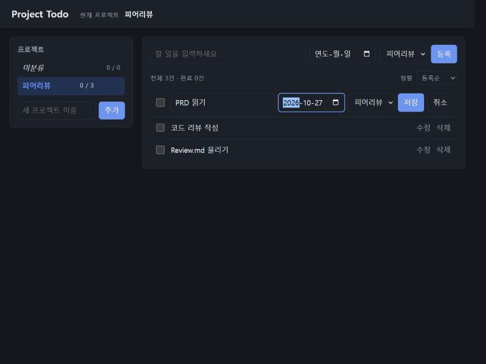
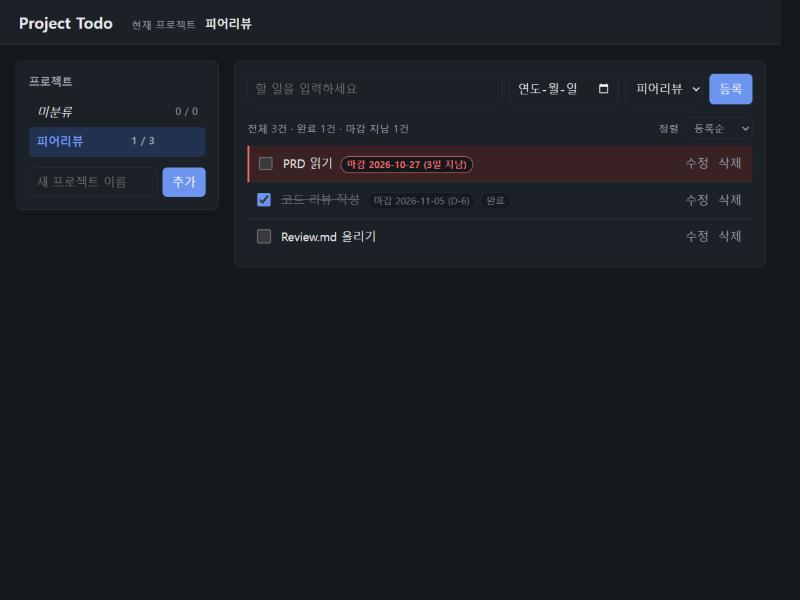
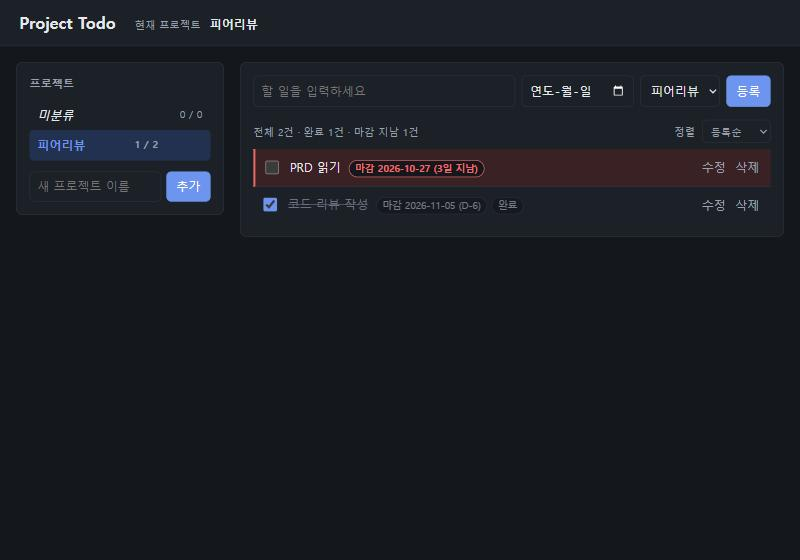
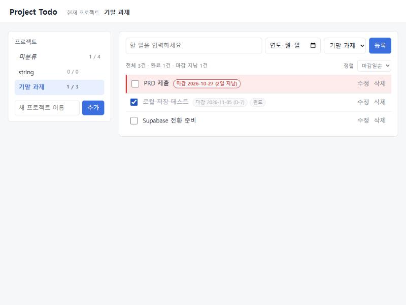
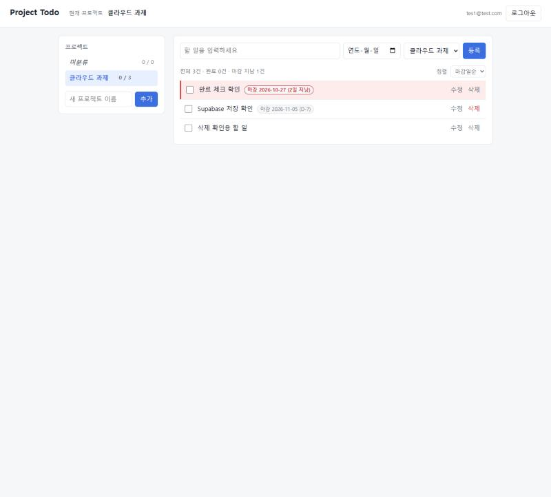

# AIFFEL Campus Agent Code Review Templete
- 개발자 : docie-rgb
- 리뷰어 : zslayer-dev

> 리뷰 대상: [docie-rgb/project-todo](https://github.com/docie-rgb/project-todo) `02291bf` (2026-10-30)
> 리뷰 방법: 코드·문서를 직접 읽고, **리뷰어 PC에서 직접 설치·실행**(Python 3.12, 로컬 SQLite 모드)해 확인했습니다. Supabase 모드는 개발자의 키가 필요해서 저장소에 첨부된 실행 화면·검증 기록으로 확인했습니다.
> 리뷰어가 만든 근거 파일: [docs/review/](docs/review/)

# ART(Agent Review Template)

[O] **1. 원하는 기능이 의도대로 동작하나요?**
- 요청(프롬프트)한 기능이 정상적으로 구현되었는지?
  - PRD의 기본 CRUD와 추가 기능(프로젝트별 분류·미분류, 마감일·마감 지남 표시·마감일순 정렬)이 모두 화면과 API에 구현되어 있습니다.
  - 길 A(SQLite) → 길 B(Supabase + 로그인)를 `.env`의 `DB_BACKEND` 하나로 바꿀 수 있고, 저장소 인터페이스([backend/repositories/base.py](backend/repositories/base.py))가 같아서 화면·API 코드는 그대로입니다. "전환 시 기존 UI와 업무 로직을 최대한 유지한다"는 PRD 7장 조건을 그대로 지켰습니다.
  - 자동 테스트 71개를 리뷰어 PC에서 다시 돌려 **71개 모두 통과**했습니다 ([docs/review/pytest-result.txt](docs/review/pytest-result.txt)).
- 실제 실행 화면/결과물을 캡처하여 근거로 첨부

**리뷰어가 직접 실행한 결과 (로컬 SQLite 모드)**

| 확인한 기능 | 결과 | 근거 |
|---|---|---|
| 프로젝트 생성 → 할 일 3개 등록 | 통과 | 아래 화면 |
| 수정 모드에서 마감일 지정 | 통과 |  |
| 완료 체크(취소선·"완료" 배지·개수 1/3), 마감 지난 미완료 빨간 표시("3일 지남"), 남은 날짜 "D-6" | 통과 |  |
| 삭제 | 통과 (API `DELETE` → 204) | 화면의 삭제 버튼은 확인 창(`confirm`)을 띄우는데, 리뷰에 쓴 자동 브라우저가 확인 창을 누를 수 없어 같은 요청을 API로 보냈습니다 |
| 서버 프로세스 완전 종료 → 재시작 → 새로고침 | 통과: 삭제한 1건은 없고, 완료·마감일 그대로 2건 유지 |  |

**개발자가 첨부한 근거 (Supabase 모드 포함)**

| 확인한 기능 | 근거 |
|---|---|
| 프로젝트·할 일 등록, 완료(취소선), 마감 지난 미완료 빨간 표시 |  |
| 로컬: 서버 완전 종료 → 재시작 후 데이터 유지 | [03-after-server-restart.jpg](docs/screenshots/03-after-server-restart.jpg), [TEST_LOG.md](TEST_LOG.md) §1-3 |
| 프로젝트 삭제 시 할 일이 미분류로 이동 / 이름 중복 거부 | [06-project-deleted-todos-unassigned.jpg](docs/screenshots/06-project-deleted-todos-unassigned.jpg), [05-duplicate-name-rejected.jpg](docs/screenshots/05-duplicate-name-rejected.jpg) |
| Supabase: 저장 → 완료 → 삭제 → 서버 재시작 후 유지 |  [13](docs/screenshots/13-supabase-completed.jpg) · [14](docs/screenshots/14-supabase-deleted.jpg) · [16](docs/screenshots/16-supabase-after-restart.jpg) |
| 재로그인(새 세션) 후에도 데이터 일치 | [docs/cloud_persistence_result.md](docs/cloud_persistence_result.md) |
| 계정 B에게 계정 A의 데이터가 보이지 않음 | [11-supabase-b-cannot-see-a.jpg](docs/screenshots/11-supabase-b-cannot-see-a.jpg) |

[O] **2. 보안 검토를 수행했나요?**
- API 키, 비밀번호 등 민감정보가 코드에 하드코딩되지 않았는지
  - 키는 `.env`에서만 읽고([backend/config.py](backend/config.py)), `.gitignore`가 `.env`·`*.db`를 제외합니다.
  - **커밋 이력 전체를 검사**했습니다: `.env`·DB 파일이 올라간 적 없음, Supabase 키·JWT·비밀번호 패턴 0건. `.env.example`의 키 칸은 모두 비어 있습니다.
  - RLS를 우회하는 secret / service_role 키를 쓰지 않고 publishable 키 + **로그인 사용자의 토큰**으로 DB에 요청합니다 ([backend/config.py:23](backend/config.py#L23)).
- 사용자 입력값 검증 등 기본 보안 사항 확인
  - 입력 모델에 정의되지 않은 필드(`user_id` 등)는 422로 거부 ([backend/schemas.py:7](backend/schemas.py#L7)). 행의 주인은 DB 기본값 `auth.uid()`가 정합니다.
  - 제목 공백·없는 날짜(`2026-02-30`) 거부 ([backend/domain.py:76](backend/domain.py#L76), [:83](backend/domain.py#L83)), SQL은 모두 `?` 매개변수화 쿼리입니다.
  - 토큰은 HttpOnly 쿠키에만 저장하고, 리프레시 토큰은 `/api/auth` 경로 + SameSite=Strict로 노출 범위를 줄였습니다 ([backend/api/cookies.py](backend/api/cookies.py)).
  - Origin 검사 + JSON만 허용하는 CSRF 방어 ([backend/main.py:39](backend/main.py#L39)), 로그인 실패 메시지를 하나로 통일해 계정 존재 여부를 숨깁니다 ([backend/supabase_auth.py:54](backend/supabase_auth.py#L54)).
  - 화면은 `textContent`로만 그려서 `innerHTML` 사용이 없습니다(XSS 방지).
  - **실행 중인 서버에 직접 요청해 확인**한 결과 ([docs/review/api-check.md](docs/review/api-check.md)):

    | 요청 | 결과 |
    |---|---|
    | 공백 제목 / 없는 날짜 `2026-02-30` | 400 거부 |
    | 요청에 `user_id` 끼워 넣기 | 422 거부 |
    | 다른 출처(Origin)에서 보낸 요청 / HTML 폼 형식 요청 | 403 / 415 거부 (CSRF 방어 동작) |
    | `/todo.db`, `/.env`, `/backend/config.py` 직접 요청 | 모두 404 (내부 파일 노출 없음) |
    | 제목 5000자 | **201, 5000자 그대로 저장** → 개선 제안 1번 |
  - RLS 정책 8개(두 테이블 × 조회·추가·수정·삭제) + **복합 외래키**로 "남의 프로젝트에 내 할 일 연결"까지 DB에서 막았고, A/B 계정으로 DB 직접·앱 API 양쪽 **26개 항목**을 검증했습니다 ([docs/rls_check_result.md](docs/rls_check_result.md)).
- 외부 데이터/의존성 사용 시 출처와 위험 검토했는지
  - 의존성 5개(fastapi, uvicorn, python-dotenv, httpx, pytest) 모두 PyPI의 널리 쓰이는 패키지이고 버전을 `==`로 고정했습니다 ([requirements.txt](requirements.txt)). 다만 의존성 취약점 점검(`pip-audit` 등) 기록은 없어서, 아래 개선 제안에 넣었습니다.

[O] **3. 에러가 난 부분을 디버깅하여 "문제를 해결한 기록"을 남겼나요?**
- 에이전트가 만든 코드의 오류를 어떻게 발견하고 수정했는지
  - [TEST_LOG.md](TEST_LOG.md) §1-5, §2-7에 "문제 / 원인 / 해결" 표로 남겼습니다. 예:
    - `.env`를 만든 뒤 테스트 7개 실패 → 테스트가 로컬 `.env`의 `DB_BACKEND=supabase`를 읽은 것이 원인 → [tests/conftest.py](tests/conftest.py)에서 테스트를 항상 sqlite 모드로 격리.
    - 테스트 계정 로그인 실패(`invalid_credentials`) → 비밀번호 없이 만든 계정으로 추정 → Create new user + Auto Confirm으로 재생성.
    - 자동 조작 중 응답 지연으로 할 일이 중복 등록된 것도 숨기지 않고 기록했습니다 (§2-8).
- 새로운 시도 및 추가 실험이 기록되어 있는지
  - 브라우저 확인에 그치지 않고 `scripts/rls_check.py`, `scripts/cloud_persistence.py`로 **재실행 가능한 검증 스크립트**를 만들었고, RLS의 "거부"가 오류가 아니라 "0건"으로 나오는 이유까지 설명했습니다 (§2-4).
  - 커밋이 Step 0 → 1-2 → 3-4 → 5 → B1~B5 단계별로 나뉘어 있어 진행 과정을 따라가기 쉽습니다.

# 참고 링크 및 코드 개선
## 1. 리뷰 시 참고한 링크가 있다면 링크와 간략한 설명을 첨부합니다.
- [Supabase - Row Level Security](https://supabase.com/docs/guides/database/postgres/row-level-security): `(select auth.uid())`로 감싸면 행마다 다시 계산하지 않는다는 성능 권장 사항. 이 코드가 그대로 따르고 있습니다.
- [PostgREST - Error codes](https://docs.postgrest.org/en/stable/references/errors.html): `42501`(권한), `23503`(외래키), `22P02`(잘못된 형식) 코드의 의미. 아래 개선 제안 2번의 근거입니다.
- [OWASP - Cross-Site Request Forgery Prevention](https://cheatsheetseries.owasp.org/cheatsheets/Cross-Site_Request_Forgery_Prevention_Cheat_Sheet.html): Origin 검사 + SameSite 쿠키 조합이 권장 방어 방식임을 확인했습니다.

## 2. 리뷰를 통해 개선을 제안할 부분이 있다면 내용과 간략한 설명을 첨부합니다.
꼭 고쳐야 하는 문제는 아니고, 다른 관점에서 생각해 본 제안입니다.

1. **제목·프로젝트 이름 길이 제한이 화면에만 있습니다.** `maxlength="200"`/`"100"`은 [frontend/index.html](frontend/index.html)에만 있고, 백엔드([backend/domain.py:76](backend/domain.py#L76))와 DB([supabase/schema.sql:37](supabase/schema.sql#L37))에는 없습니다. **실제로 API에 5000자 제목을 보내니 201로 그대로 저장**됐습니다([api-check.md](docs/review/api-check.md)). `clean_title`에 길이 검사를 넣거나 `check (length(title) <= 200)`을 추가하면 화면과 규칙이 같아집니다.
2. **Supabase 모드에서 잘못된 형식의 ID가 503으로 응답될 것으로 보입니다.** (코드 읽기로 찾은 것이라 Supabase 모드에서 직접 확인은 못 했습니다.) SQLite 모드에서 `PATCH /api/todos/abc`는 404로 잘 응답합니다. 그런데 Supabase에서는 PostgREST가 `22P02`(uuid 형식 아님)로 400을 주고, [supabase_repo.py:109](backend/repositories/supabase_repo.py#L109)에서 "데이터 저장소 오류"(503)로 바뀝니다. `22P02`를 404로 바꿔 주면 두 모드의 응답이 같아집니다.
3. **로그인 시도 횟수 제한이 없습니다.** Supabase Auth가 IP 기준으로 제한하지만, Render에 배포하면 모든 요청이 서버 IP 하나로 나가서 한 사람의 반복 시도가 다른 사용자 로그인까지 막을 수 있습니다. 배포한다면 `/api/auth/login`에 간단한 횟수 제한을 두는 것을 검토해 볼 만합니다.
4. **의존성 취약점 점검 기록을 남겨 보세요.** `pip install pip-audit` 후 `pip-audit -r requirements.txt` 결과를 TEST_LOG에 한 줄 남기면 ART 2번의 "외부 의존성 위험 검토" 근거가 됩니다.
5. **LEARNING_NOTES.md의 B1~B6 칸이 비어 있습니다.** 양식은 잘 만들어 두셨는데, "발생한 오류와 해결 과정" 칸에 TEST_LOG의 내용을 본인 말로 한두 줄씩 옮기면 회고 자료로 더 좋아질 것 같습니다.
6. **보안 응답 헤더가 없습니다.** 실행해 보니 `X-Content-Type-Options`, `X-Frame-Options`, `Content-Security-Policy`가 없고 `server: uvicorn`이 노출됩니다([api-check.md](docs/review/api-check.md) §4). 배포한다면 미들웨어로 이 헤더들을 붙이면 다른 사이트에 몰래 끼워 넣는 공격(클릭재킹) 등을 막을 수 있습니다.
7. (사소) 로컬 스크린샷에 Swagger 테스트로 만든 듯한 `string` 프로젝트가 보입니다 ([01-before-restart.jpg](docs/screenshots/01-before-restart.jpg)).

# 총평
PRD → DB 설계 → 단계별 구현 → 자동 테스트 → RLS·영속성 검증까지 근거가 빠짐없이 연결된, 완성도가 아주 높은 과제입니다. 특히 RLS 정책만이 아니라 **복합 외래키로 "남의 프로젝트에 연결"까지 DB에서 막은 설계**, 백엔드를 거치지 않고 Supabase에 직접 요청해 RLS를 검증한 스크립트, 그리고 실패·중복 등록 같은 문제를 숨기지 않고 원인과 함께 기록한 점이 인상적이었습니다. 저도 제 과제에서 "다른 사용자의 데이터에 연결하는 것"까지는 생각하지 못했는데, 이 부분은 배워 갑니다. 개선 제안은 대부분 배포를 염두에 둔 작은 보완점입니다.
